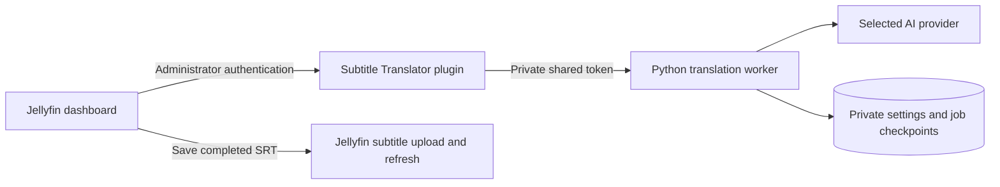
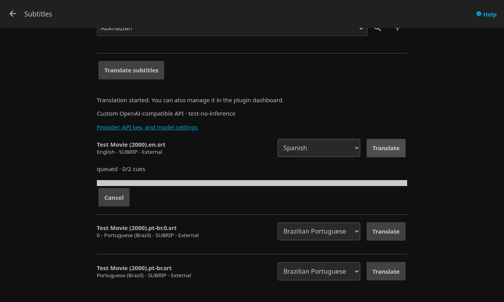

# jellySubsTranslator

Translate existing subtitle tracks from Jellyfin’s dashboard using **OpenAI, Google Gemini, Anthropic Claude, Meta Muse, Ollama**, or a custom OpenAI-compatible API.

Select a provider, choose a model from its dropdown, enter your own API key, and manage translation jobs inside Jellyfin. From a movie or episode, open **More → Edit subtitles → Translate subtitles** to see its subtitle files, choose a target language beside a file, and start translating. Translation runs in a separate Python service so jobs can continue when you close the page.

**Tested with Jellyfin 12.4.0 / .NET 10 and the LinuxServer Jellyfin Docker image.** This is an administrator dashboard plugin. It translates existing text subtitles; it does not perform live playback translation, transcribe audio, or OCR image subtitles.

## Features

- **Translate subtitles** inside Jellyfin Web’s existing **Edit subtitles** dialog.
- One target-language selector and Translate button per subtitle file.
- Provider selector with a provider-dependent model selector.
- Live model discovery using your saved credentials, plus custom model IDs.
- Separate saved API keys for each provider; keys are never returned to the browser.
- Embedded and external text subtitle extraction through Jellyfin.
- Batched translation with adjacent dialogue context.
- Original subtitle cue numbers and timestamps preserved.
- Validation that rejects missing, duplicate, empty, or malformed translated cues.
- Persistent job queue, progress, cancellation, and resumable checkpoints.
- Duplicate-job detection to avoid translating the same source/settings twice.
- Completed SRT download or **Save to library** through Jellyfin’s subtitle API.
- Shared command-line translator with no third-party Python dependencies.

## How it works



The plugin adds a dashboard page and authenticated API bridge. The worker stores jobs and calls the selected provider. It has no media-directory mounts and no published host port. A completed subtitle is saved to the media library when you click **Save to library**; saving does not depend on a separate Jellyfin API key.

## Requirements

- Jellyfin 12.4.0 on .NET 10. Other versions require rebuilding and testing against their assemblies.
- Docker with Compose v2, and Python 3.10+ for the setup/build helpers and optional CLI.
- A writable Jellyfin configuration directory and permission to save external subtitles in the selected media folder.
- An API account/key for a cloud provider, or a reachable Ollama server with an installed text model.

A ChatGPT, Gemini, Claude, or Muse consumer subscription is not used as API authentication; supply the provider’s developer API credentials where required. No provider account is created by this project.

## Install with Docker

These instructions use an existing LinuxServer Jellyfin container named `jellyfin`. Substitute your container name and paths as necessary. The included build script uses `/usr/lib/jellyfin/bin` inside that image; other Jellyfin image layouts need corresponding adjustments.

### 1. Get the source and prepare private settings

```sh
git clone https://github.com/tutitui/jellySubsTranslator.git
cd jellySubsTranslator
python3 scripts/prepare.py
```

This creates:

- `runtime/bridge.env`: a generated token shared by Jellyfin and the worker.
- `runtime/settings.json`: private provider configuration, initially without API keys.

The runtime directory is mode `0700`; the settings/token files are mode `0600`. The worker runs as UID/GID `1000:1000`. If your account uses another UID/GID, adjust the Dockerfile’s `USER` and runtime directory ownership before starting it.

**Do not commit `runtime/`, provider keys, or translation databases.** They are excluded by `.gitignore`.

### 2. Build the plugin against your server

```sh
JELLYFIN_CONTAINER=jellyfin scripts/build-plugin.sh
```

The script copies Jellyfin’s public plugin reference assemblies from the existing container, then builds with the .NET 10 SDK in Docker. It writes the DLL, dependency metadata, and `meta.json` to `artifacts/`.

For a build without an existing server:

```sh
JELLYFIN_IMAGE=linuxserver/jellyfin:latest scripts/build-plugin.sh
```

Use the same server image/version you intend to deploy. The plugin targets .NET 10 and declares Jellyfin 12.4 compatibility; a future incompatible Jellyfin update may require code and metadata changes as well as a rebuild.

### 3. Give Jellyfin the shared token

Add this to your **existing Jellyfin service** in its Compose file, preserving its current environment and mounts:

```yaml
services:
  jellyfin:
    # Keep your existing image, ports, environment, and volumes.
    env_file:
      - /absolute/path/to/jellySubsTranslator/runtime/bridge.env
    volumes:
      # Append these to your existing Jellyfin volumes.
      - /absolute/path/to/jellySubsTranslator/web:/subtitle-translator-web:ro
      - /absolute/path/to/jellySubsTranslator/scripts/init-web-ui.sh:/custom-cont-init.d/98-subtitle-translator-web.sh:ro
```

The environment file contains only the private plugin-to-worker token, not a provider API key. The two added mounts enable the movie-level UI. On every LinuxServer container startup, the hook copies the credential-free client extension and adds one versioned script reference to Jellyfin Web’s `index.html`. It is idempotent and keeps your other web customizations. Without the hook, the dashboard plugin still works, but the movie-level button is unavailable.

### 4. Start the worker on Jellyfin’s Docker network

Find the network used by your Jellyfin container:

```sh
docker inspect jellyfin --format '{{json .NetworkSettings.Networks}}'
```

Then start the worker, replacing `docker_default` if your network has another name:

```sh
JELLYFIN_DOCKER_NETWORK=docker_default \
  docker compose -f compose.example.yml up -d --build
```

The worker must be reachable from Jellyfin as `http://subtitle-translator:8788`. The example uses an existing external network and does not publish port 8788 to the host. Alternatively, add the worker service to your existing Jellyfin Compose project and use its default network.

### 5. Install the plugin and recreate Jellyfin

```sh
docker exec jellyfin mkdir -p '/config/data/plugins/Subtitle Translator_1.0.0.0'
docker cp artifacts/Jellyfin.Plugin.SubtitleTranslator.dll \
  'jellyfin:/config/data/plugins/Subtitle Translator_1.0.0.0/'
docker cp artifacts/Jellyfin.Plugin.SubtitleTranslator.deps.json \
  'jellyfin:/config/data/plugins/Subtitle Translator_1.0.0.0/'
docker cp artifacts/meta.json \
  'jellyfin:/config/data/plugins/Subtitle Translator_1.0.0.0/'
```

Recreate Jellyfin from **its existing Compose project** so it receives the new `env_file`:

```sh
docker compose -f /path/to/your/jellyfin/compose.yml up -d --no-deps jellyfin
```

A plain `docker restart` does not apply new environment variables. Jellyfin’s `/config` must be backed by persistent storage so installed plugins survive recreation. For a non-LinuxServer installation, use that server’s actual plugin directory instead of `/config/data/plugins`.

## Configure providers and models

Open **Dashboard → Plugins → Subtitle Translator**. The page is also linked in the dashboard’s server menu.

1. Select an **AI provider**.
2. Enter its **API key**. Ollama normally needs no key.
3. Select a **model** from the dropdown.
4. Click **Save settings** or **Refresh models** to save the key and query the provider’s available models.
5. If a model is missing or the endpoint does not implement model discovery, select **Other — enter model ID**.

Before a key is configured, the model dropdown offers a suggested default. Model discovery does not generate translations. Returned model lists can include models that are incompatible with text-chat/JSON generation; select a suitable text model available to your account.

Leaving the key field blank retains its saved value. Use **Remove this provider’s saved key** to delete it. Switching providers keeps their credentials separate. Keys are server-wide plugin settings managed by Jellyfin administrators, not per-viewer credentials.

| Provider | Integration | Model discovery |
| --- | --- | --- |
| OpenAI | Chat Completions at `https://api.openai.com/v1` | Account model list, filtered for likely chat models |
| Google Gemini | Native `generateContent` API | Models supporting `generateContent` |
| Anthropic Claude | Native Messages API | Account model list |
| Meta Muse | OpenAI-compatible Meta Model API at `https://api.meta.ai/v1` | Account model list |
| Ollama | Native `/api/chat` | Installed models from `/api/tags` |
| Custom | OpenAI-compatible `/chat/completions` | `/models`, when implemented |

Hosted provider endpoints are fixed to their official URLs. Ollama and Custom expose an endpoint field. Custom endpoints must support JSON-object responses in text chat; include `/v1` in the base URL if your endpoint requires it.

For Meta Muse, use a [Meta Model API](https://dev.meta.ai/) key and an available Muse model, rather than a Muse website login. For local inference, configure Ollama with an installed model.

### Ollama from Docker

The worker’s example base URL is `http://host.docker.internal:11434`; the Compose example adds a host-gateway mapping. Ollama must listen on an interface reachable from Docker. If Ollama runs in another container, connect it to the same network and use its service URL, for example `http://ollama:11434`.

This project does not install Ollama or download models. Model quality, speed, and JSON compliance depend on the model you choose.

## Translate from a movie or episode

1. Open the video’s **More → Edit subtitles** menu.
2. Click **Translate subtitles**, below the existing subtitle search controls.
3. The panel lists existing external subtitle files first, followed by embedded tracks. Image tracks are listed but cannot be translated without OCR.
4. Select a target language beside the desired source subtitle and click **Translate**.
5. Confirm the provider/model and cue count. The row shows job progress, cancellation, and retry controls.
6. When complete, click **Save to movie folder** to upload the SRT through Jellyfin and refresh the item. Reopen the subtitle editor to see the new file.



This integration extends **Jellyfin Web 12.4**. It also works in clients that load that customized web UI, but does not modify separate native Android, iOS, TV, or desktop UIs. Jellyfin Web updates can change the subtitle editor’s DOM, so the integration needs retesting after a server/client upgrade.

### Translate from the dashboard

1. Search for a movie or episode on the plugin dashboard.
2. Select the video, an existing text subtitle track, and the target language.
3. Click **Start translation** and confirm the provider, model, and cue count.
4. Monitor the job or leave the page; the worker keeps processing.
5. After completion, click **Save to library** or **Download SRT**.

Jellyfin refreshes the item after saving. If a subtitle in the target language already exists, the dashboard asks before an upload that may replace an external subtitle for that language. The source is not rewritten by the translator.

Target languages include Brazilian and European Portuguese, English, Spanish, French, German, Italian, Japanese, Korean, Chinese, Arabic, Russian, and Hindi.

### Retry, cancel, and resume

Each successful batch is checkpointed. Provider errors leave the job and original source intact; **Resume / retry** continues missing cues instead of restarting the whole subtitle. A retry uses the job’s original provider/model/endpoint and that provider’s currently saved key.

Cancellation takes effect after the current provider request/batch returns. A service restart pauses queued/running work until an administrator resumes it, preventing an unexpected restart from automatically beginning paid requests.

Duplicate requests with the same subtitle, video, track, language, provider, model, and endpoint return the existing job. There is one translation worker and a maximum of ten queued/running jobs. Inputs are limited to 2 MiB and 20,000 cues.

## Command-line use

The CLI uses the same translation engine and private provider settings:

```sh
python3 subsTranslator.py movie.en.srt --target pt-BR
python3 subsTranslator.py movie.en.srt --target es --provider gemini
python3 subsTranslator.py movie.en.srt --source en --target fr --model MODEL_ID
```

Run without a file or target to use interactive prompts. Use `--settings PATH` or `SUBTITLE_TRANSLATOR_SETTINGS` to select another settings file; the default is this repository’s `runtime/settings.json`.

Provider environment variables override saved keys: `OPENAI_API_KEY`, `GEMINI_API_KEY`, `ANTHROPIC_API_KEY`, `MODEL_API_KEY`, or `TRANSLATOR_API_KEY` for Ollama/Custom.

The CLI writes language-tagged output such as `movie.pt-BR.srt` and refuses to overwrite a source or existing output. Checkpoints are stored beside the intended output as `*.progress.json`; rerun with the same options after an interruption to resume. Only SRT input is accepted by the CLI. Convert other text subtitle formats first; image formats need OCR.

## Privacy, cost, and limitations

- Only Jellyfin administrators can use the plugin’s routes. Normal viewers and unauthenticated requests are denied.
- Provider keys are kept in private server-side settings and never returned by the settings API or embedded in the plugin DLL, browser code, or image.
- Selected subtitle dialogue and nearby context are sent to the selected provider when you start/resume a job. Ollama keeps inference on the configured local server.
- Cloud providers bill the configured account. This project does not include API credits or enable automatic whole-library translation.
- Reported token usage covers successful parsed responses and is not an invoice; providers may also bill invalid responses that are retried.
- Jobs and input/output text persist in `runtime/jobs.db`. Back up or remove that private data according to your needs.
- The worker has no host-published port or media mount. It uses a shared token for the internal bridge and runs without Linux capabilities on a read-only root filesystem.
- AI translation can make semantic errors. Review important subtitles. The code validates structure and completeness, not linguistic accuracy.
- PGS, VobSub, and other image subtitles are excluded. Audio transcription, OCR, live translation, normal-viewer controls, and automatic import without clicking **Save to library** are not implemented.

## Development and testing

```text
plugin/       .NET plugin, authenticated controller, embedded dashboard
worker/       Standard-library Python provider adapters, queue, server, CLI
scripts/      Settings preparation, plugin build, and web UI startup hook
web/          Credential-free Jellyfin Web subtitle-editor extension
tests/        Mocked provider/queue tests and optional isolated integration test
```

Run no-charge tests:

```sh
python3 -m unittest discover -s tests -v
python3 -m py_compile worker/*.py scripts/prepare.py
```

Tests cover provider request/response formats, key redaction, invalid responses, cue/timestamp preservation, deduplication, cancellation, and failure/resume across batches. CI also builds the plugin against a LinuxServer Jellyfin image and uploads its build artifacts.

`tests/integration.py` is an optional manual harness for disposable Jellyfin/worker containers on `127.0.0.1:18096`, using local fixture data under `integration/`. It initializes a test server, creates synthetic library data, and exercises plugin authentication, source extraction, and mocked subtitle upload. It intentionally fails unless that isolated environment is prepared; **do not point it at a production server**. No real provider inference is needed.

For the optional browser harness, first prepare the same disposable integration environment, install `playwright-core` as a development-only dependency, then run `node tests/browser_smoke.cjs`. It uses Chrome at `/usr/bin/google-chrome`; set `CHROME_PATH` for another installation. Browser job submission is mocked.

The initial implementation was also checked in Chrome for provider/model selection, movie search, subtitle-track selection, and **Edit subtitles → Translate subtitles**. The editor test verified file rows and submitted the selected source and target language to a mocked job endpoint. Real provider inference has not been exercised by these automated tests.

## Troubleshooting

| Symptom | Check |
| --- | --- |
| Movie-level button is missing | Confirm the web extension and startup-hook mounts, recreate Jellyfin, and refresh the web client. Check that the user is an administrator. |
| Plugin is missing | Confirm its DLL and `meta.json` are in the persistent plugin directory, then restart Jellyfin. Check server logs for plugin-load errors. |
| Service token is not configured | Add the shared `bridge.env` to the Jellyfin service and recreate its container. |
| Translation service unavailable | Confirm the worker is healthy, shares Jellyfin’s Docker network, and resolves as `subtitle-translator`. |
| Model list unavailable | Save the correct provider key/endpoint, then refresh; use a custom model ID if discovery is unsupported. |
| HTTP 401/403 from provider | Check the API key, provider account permissions, and model access. Saved progress remains available. |
| Ollama connection fails | Check its listening address, Docker network, port, and installed model. `localhost` inside the worker means the worker itself. |
| No source tracks | Supply an existing text subtitle or OCR an image subtitle before translating. |
| Subtitle cannot be saved | Verify Jellyfin has write permission to the media folder and the target mount is writable. |
| Job paused after restart | Resume it from the dashboard; it will use saved progress. |

## License

[MIT](LICENSE).
